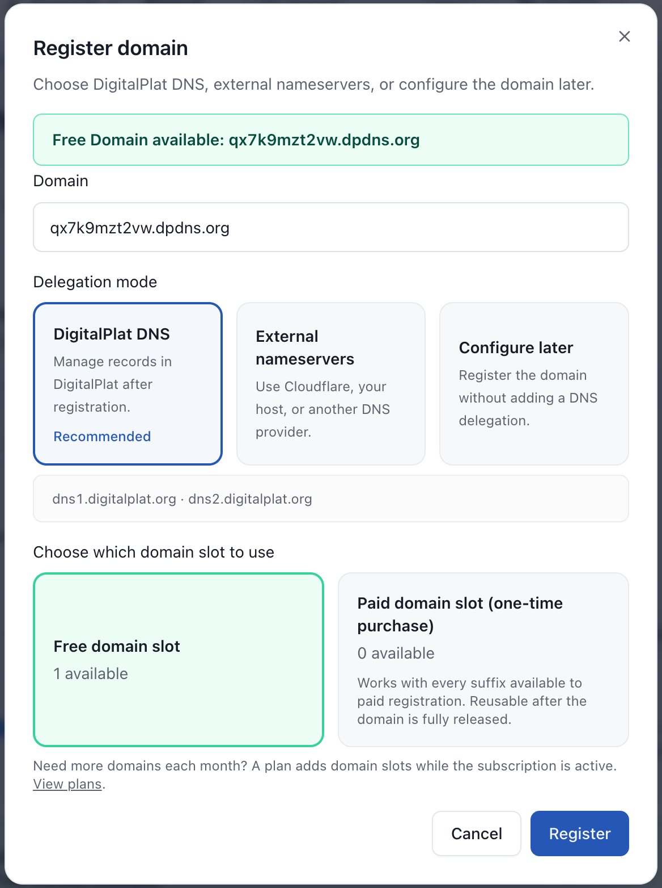
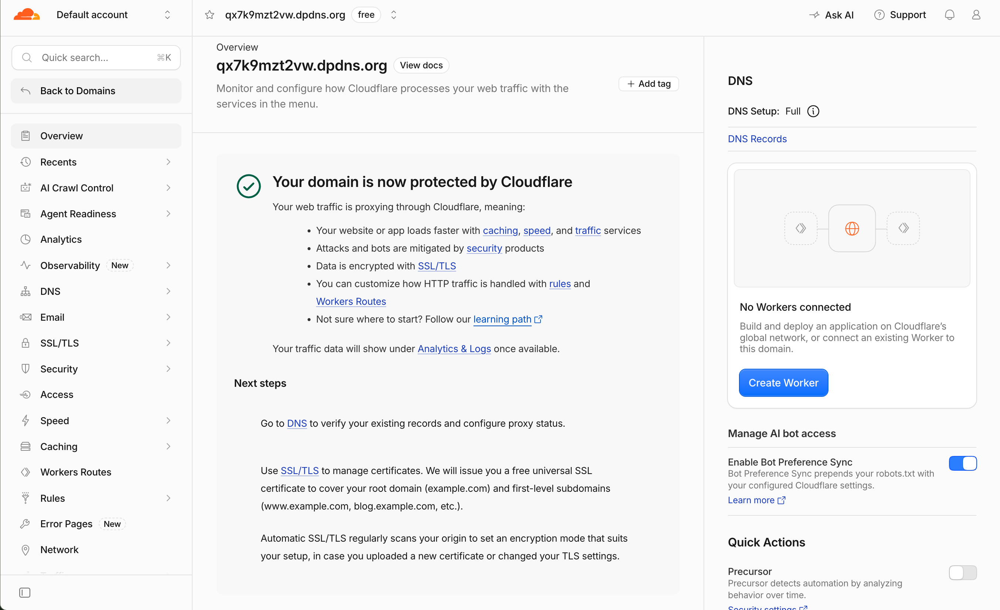
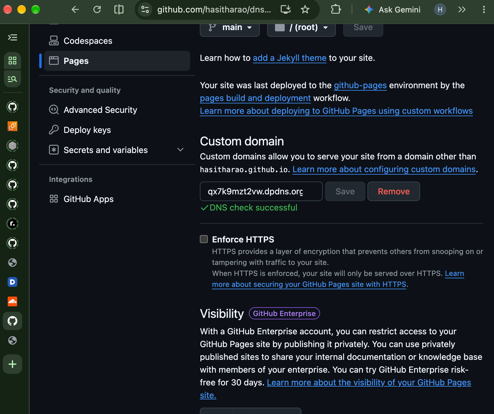
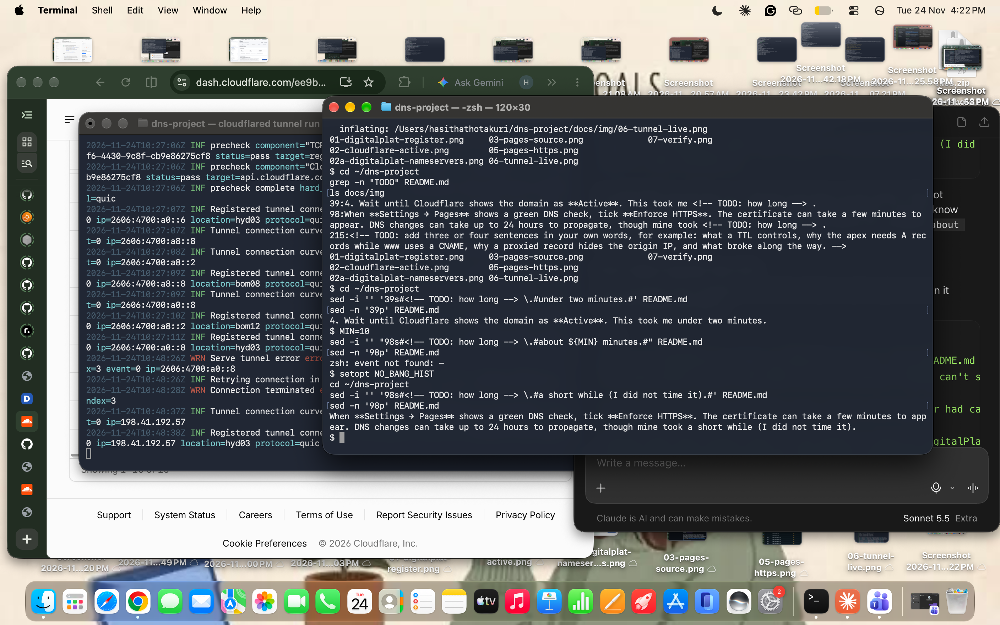
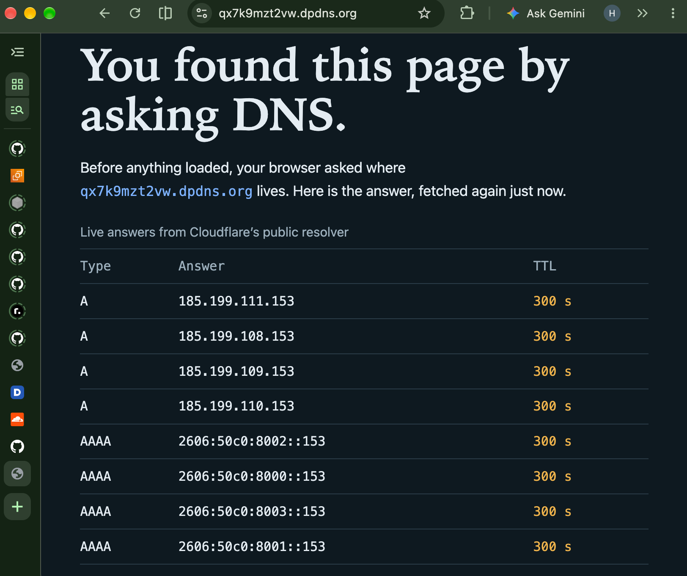
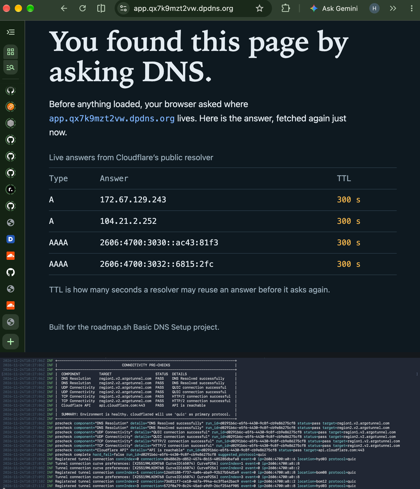
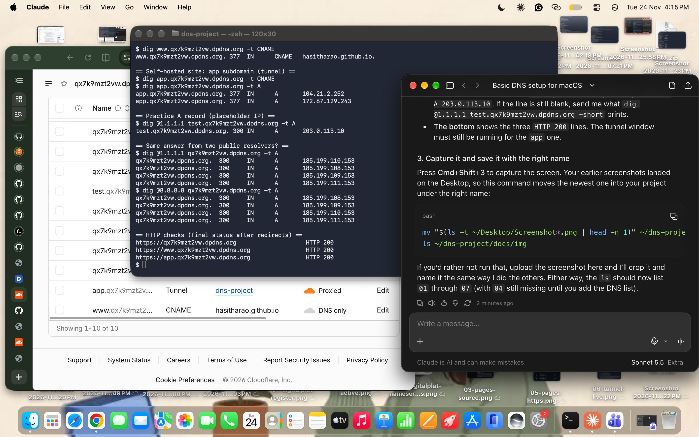

# Basic DNS Setup: one domain, two sites

My write-up for the [roadmap.sh Basic DNS Setup project](https://roadmap.sh/projects/basic-dns-setup). I pointed one custom domain at a GitHub Pages site (Task 1) and at a second site served from my own machine (Task 2).

| Hostname | Points to | Record type |
|---|---|---|
| `qx7k9mzt2vw.dpdns.org` | GitHub Pages | A and AAAA |
| `www.qx7k9mzt2vw.dpdns.org` | GitHub Pages | CNAME |
| `app.qx7k9mzt2vw.dpdns.org` | Site on my Mac, through a Cloudflare Tunnel | CNAME (created by the tunnel) |
| `test.qx7k9mzt2vw.dpdns.org` | A placeholder IP, to practise an A record | A |

## Two deviations from the brief

I had no payment method to use for this project, so I changed two things. Everything else follows the brief.

1. **Free domain instead of a purchased one.** I registered a free `.dpdns.org` domain from [DigitalPlat FreeDomain](https://dash.domain.digitalplat.org/) and delegated it to Cloudflare's free DNS. I still manage every record myself in a normal DNS dashboard.
2. **My Mac instead of a DigitalOcean Droplet.** A cloud VM needs a card on file, so I served the second site from my laptop and published it with a Cloudflare Tunnel. A tunnel creates a CNAME to a Cloudflare address, not an A record to a server IP. To still practise the A-record flow, I added a `test` record that points to `203.0.113.10`, an address reserved for documentation, and checked it with `dig`. If you have a VPS, skip to [Using a real server](#using-a-real-server-instead).

## Prerequisites

- A Mac with [Homebrew](https://brew.sh)
- A GitHub account and the GitHub CLI: `brew install gh && gh auth login`
- A free [Cloudflare](https://dash.cloudflare.com/sign-up) account
- The files in this repo: `index.html`, `verify.sh`, and this README

## Step 1: Register the free domain

1. Open the [DigitalPlat dashboard](https://dash.domain.digitalplat.org/) and create an account.
2. Choose **Register domain**, enter a name, and select the `.dpdns.org` extension. Other extensions can charge a fee, so I used this one.
3. Check availability and register it. Leave the nameserver fields empty for now.



## Step 2: Move DNS to Cloudflare

1. In Cloudflare, choose **Add a domain** and enter `qx7k9mzt2vw.dpdns.org`.
2. Pick the **Free** plan. Cloudflare shows two nameservers.
3. Back at DigitalPlat, paste those two nameservers into the domain's nameserver fields and save.
4. Wait until Cloudflare shows the domain as **Active**. This took me under two minutes.



You can check the delegation from the terminal. The answer should list Cloudflare nameservers:

```bash
dig qx7k9mzt2vw.dpdns.org NS +noall +answer
```

## Step 3 (Task 1): Custom domain for GitHub Pages

### Publish the site

```bash
mkdir -p ~/dns-project && cd ~/dns-project   # put index.html in this folder
git init -b main
git add . && git commit -m "Initial site"
gh repo create dns-project --public --source=. --push
```

In the repo, open **Settings → Pages**. Under **Build and deployment**, set the source to **Deploy from a branch**, branch `main`, folder `/ (root)`. The site is now live at `https://hasitharao.github.io/dns-project/`.



### Add the domain to GitHub first

Under **Settings → Pages → Custom domain**, enter `qx7k9mzt2vw.dpdns.org` and click **Save**. Do this before creating the DNS records. GitHub's docs warn that adding records first can let someone else claim a subdomain.

GitHub also commits a `CNAME` file to the repo, so run `git pull` before your next push.

### Create the DNS records

In Cloudflare, open **DNS → Records** and add the following. Set every record's proxy status to **DNS only** (grey cloud) so GitHub can verify the domain and issue a certificate.

| Type | Name | Content |
|---|---|---|
| A | `@` | `185.199.108.153` |
| A | `@` | `185.199.109.153` |
| A | `@` | `185.199.110.153` |
| A | `@` | `185.199.111.153` |
| AAAA | `@` | `2606:50c0:8000::153` |
| AAAA | `@` | `2606:50c0:8001::153` |
| AAAA | `@` | `2606:50c0:8002::153` |
| AAAA | `@` | `2606:50c0:8003::153` |
| CNAME | `www` | `hasitharao.github.io` |

These are the addresses in [GitHub's custom domain documentation](https://docs.github.com/en/pages/configuring-a-custom-domain-for-your-github-pages-site/managing-a-custom-domain-for-your-github-pages-site) at the time of writing. Check that page if anything fails, since GitHub can change them.



### Verify and turn on HTTPS

```bash
dig qx7k9mzt2vw.dpdns.org +noall +answer -t A
dig qx7k9mzt2vw.dpdns.org +noall +answer -t AAAA
dig www.qx7k9mzt2vw.dpdns.org +noall +answer
```

When **Settings → Pages** shows a green DNS check, tick **Enforce HTTPS**. The certificate can take a few minutes to appear. DNS changes can take up to 24 hours to propagate, though mine took a short while (I did not time it).



Visiting `https://qx7k9mzt2vw.dpdns.org` and `https://www.qx7k9mzt2vw.dpdns.org` should both load the site, with `www` redirecting to the apex.

## Step 4 (Task 2): A second site on my Mac

### Serve the site locally with nginx

```bash
brew install nginx cloudflared
```

Create `/opt/homebrew/etc/nginx/servers/app.conf`. Replace `YOUR_MAC_USER` with the output of `whoami`:

```nginx
server {
    listen 8080 default_server;
    server_name app.qx7k9mzt2vw.dpdns.org;
    root /Users/YOUR_MAC_USER/dns-project;
    index index.html;

    location / {
        try_files $uri $uri/ =404;
    }
}
```

```bash
nginx -t && brew services start nginx
curl -I -H "Host: app.qx7k9mzt2vw.dpdns.org" http://localhost:8080        # expect HTTP/1.1 200 OK
```

### Publish it with a Cloudflare Tunnel

```bash
cloudflared tunnel login                       # opens a browser; choose qx7k9mzt2vw.dpdns.org
cloudflared tunnel create dns-project          # prints a tunnel ID (UUID)
cloudflared tunnel route dns dns-project app.qx7k9mzt2vw.dpdns.org
```

The last command creates the `app` DNS record for me. Unlike my other records, this one stays **Proxied** (orange cloud), because the tunnel needs it.

Create `~/.cloudflared/config.yml` with the real tunnel ID in both places:

```yaml
tunnel: TUNNEL_ID
credentials-file: /Users/YOUR_MAC_USER/.cloudflared/TUNNEL_ID.json

ingress:
  - hostname: app.qx7k9mzt2vw.dpdns.org
    service: http://localhost:8080
  - service: http_status:404
```

Start the tunnel and leave it running:

```bash
cloudflared tunnel run dns-project
```



Because the record is proxied, `dig app.qx7k9mzt2vw.dpdns.org` returns Cloudflare addresses, not my laptop's. The tunnel connects outward from my Mac, so I opened no ports on my router.

### Practise an A record

I added one more record to rehearse the A-record flow from the brief:

| Type | Name | Content |
|---|---|---|
| A | `test` | `203.0.113.10` |

```bash
dig test.qx7k9mzt2vw.dpdns.org +noall +answer -t A
```

That IP is reserved for documentation, so nothing is served from it. With a real server, this is the record I would point at its public IP.

## Step 5: Verify everything at once

```bash
chmod +x verify.sh
./verify.sh qx7k9mzt2vw.dpdns.org
```

The script checks the nameservers, every record above, two public resolvers, and the HTTP status of each site.



## Using a real server instead

If you have a VPS (for example a DigitalOcean Droplet), the DNS side is simpler than the tunnel:

1. Serve the site with nginx on the server, with `server_name app.qx7k9mzt2vw.dpdns.org;`.
2. Add `A  app  <droplet IPv4>` in your DNS dashboard, and an AAAA record if the server has IPv6.
3. Check it with `dig app.qx7k9mzt2vw.dpdns.org +short`, which should print the server's IP.
4. Run `sudo certbot --nginx -d app.qx7k9mzt2vw.dpdns.org` once the record resolves.

## Troubleshooting

| Symptom | What to check |
|---|---|
| `dig` returns nothing | Propagation or caching. Ask a public resolver directly: `dig @1.1.1.1 qx7k9mzt2vw.dpdns.org` |
| Cloudflare never shows Active | The nameservers at DigitalPlat don't match the two Cloudflare gave you |
| GitHub says the DNS check failed | A leftover default record is conflicting, or a record is still proxied (orange cloud) |
| GitHub 404 page on the custom domain | The custom domain isn't saved under Settings → Pages |
| `app.` shows a Cloudflare 502 or 1033 error | The tunnel isn't running, or nginx isn't listening on port 8080 |
| Tunnel works but the page is blank | The nginx `root` path is wrong. Run `nginx -t` and check the folder exists |

## Cleanup

Stop the tunnel with Ctrl+C and run `brew services stop nginx`. Nothing here bills by the hour, so leaving the DNS records in place costs nothing.

## What I learned

The apex domain uses A and AAAA records because a CNAME can't share the zone root with other records, while `www` is a CNAME to `hasitharao.github.io` so GitHub can change its servers without me touching DNS. The page shows a TTL of 300 seconds, which is Cloudflare's Auto setting: resolvers may cache an answer that long before asking again. The `app` record is proxied, so `dig` returns Cloudflare's addresses and not my laptop's, and the tunnel only makes outbound connections, so I opened no ports on my router.

A new record can stay invisible for a while. My resolver had cached the earlier "this name doesn't exist" answer, so `dig` showed nothing for `test` even though Cloudflare's nameserver returned it immediately. Asking the authoritative nameserver or another public resolver showed the record was there.

Things that went wrong: most of the names I tried at DigitalPlat were refused until I tried a random one; nginx kept showing its default welcome page because it picks a server block by hostname, so I had to test with a `Host` header; and my first tunnel config had a placeholder ID in it, which `cloudflared` rejected until I used the real one.
